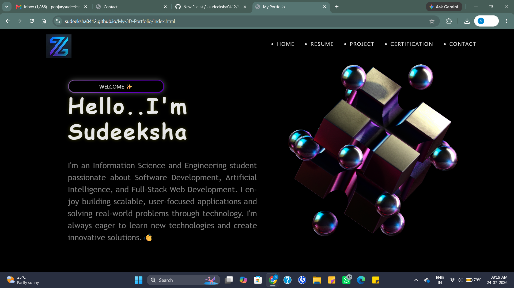
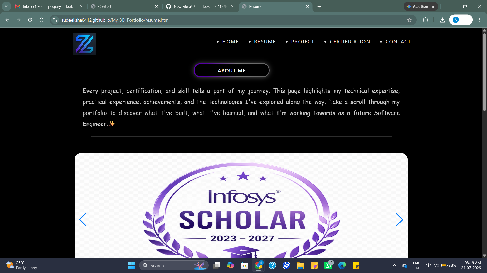
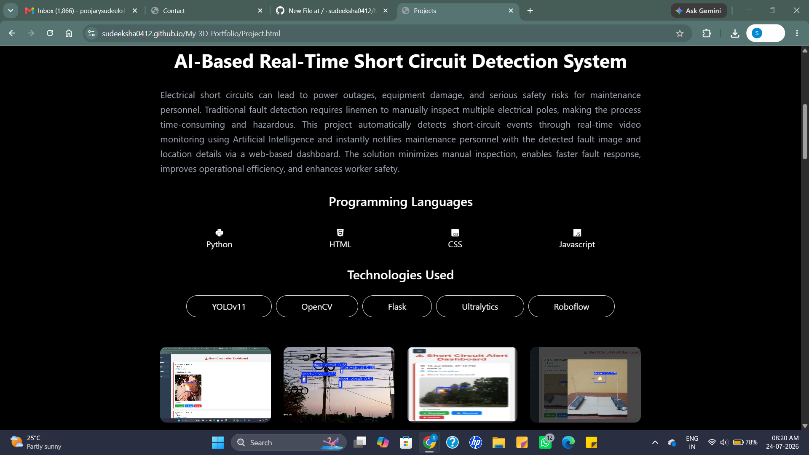
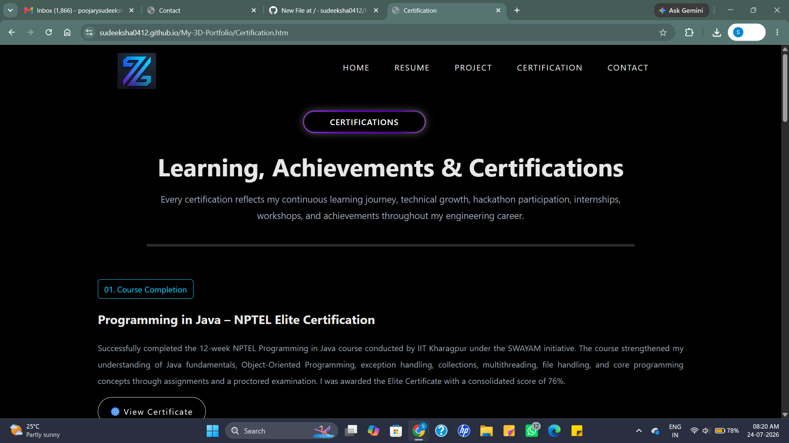
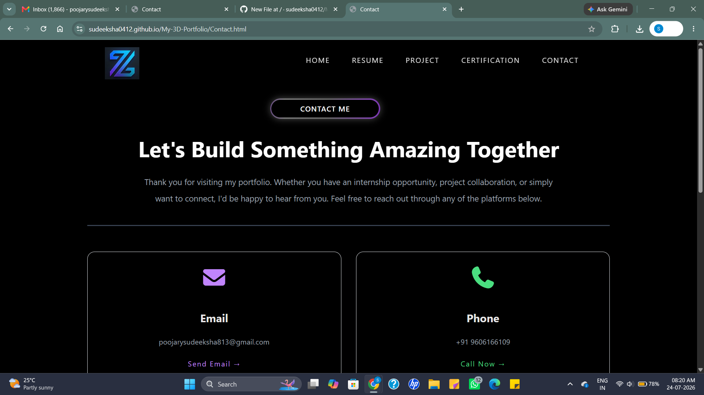
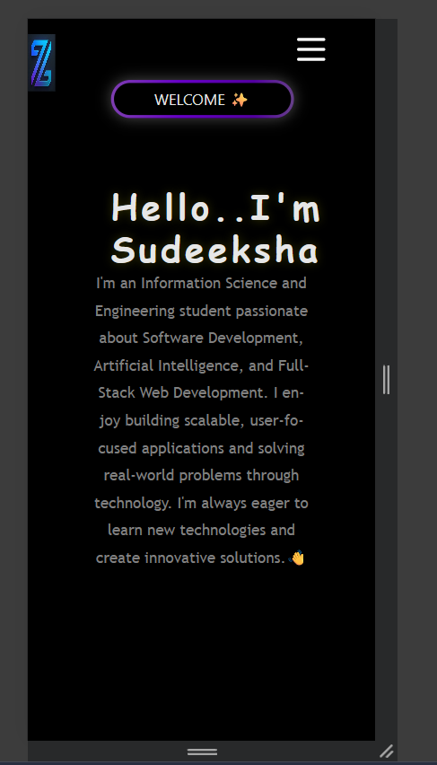

# 🌐 3D Personal Portfolio Website

A modern, responsive, and interactive **3D-inspired portfolio website** designed to showcase my projects, technical skills, certifications, resume, and contact information.

The portfolio combines **Spline 3D elements**, smooth animations, glassmorphism, glowing UI effects, and responsive layouts to create an engaging user experience across all devices. Every page is designed with a clean, modern interface that highlights my journey, achievements, and software development projects while providing seamless navigation and interactive visual effects.

---

## 🚀 Live Features

- 🏠 Home Page
- 👩‍💻 Resume Page
- 💼 Projects Showcase
- 📜 Certifications
- 📞 Contact Page
- 🌌 Interactive 3D Design using Spline
- ✨ Smooth Animations
- 📱 Fully Responsive Design
- 🎨 Modern Glassmorphism UI
- 🍔 Mobile Navigation Menu

---

## 🛠️ Technologies Used

- HTML5
- CSS3
- JavaScript
- Tailwind CSS
- Bootstrap 5
- Font Awesome
- AOS (Animate On Scroll)
- Swiper.js
- Spline 3D

---

## ✨ Features

### 🏠 Home

- Professional introduction
- Interactive Spline 3D Scene
- Animated Hero Section
- Skills Overview
- Smooth Navigation
- Responsive Design

### 👨‍💻 Resume

- About Me
- Technical Skills
- Technology Stack
- Education
- Download Resume
- Contact Links

### 💼 Projects

Projects included:

- AI-Based Real-Time Short Circuit Detection System
- Jobby – AI Interview Helper Chatbot
- Real Estate Management System
- Intelligent Robotic System for Cow Dung Detection & Collection

Each project includes:

- Description
- Programming Languages
- Technologies Used
- Image Gallery
- GitHub Repository Link

### 📜 Certifications

- Professional Certifications
- Internship Certificates
- Workshop Participation
- Academic Achievements

### 📞 Contact

- Email
- Phone
- Location
- LinkedIn
- GitHub
- Resume Download
- Responsive Contact Cards

---

## 🌟 UI Highlights

- 🌌 Interactive Spline 3D Design
- ✨ Smooth Page Animations
- 🎨 Modern Glassmorphism Interface
- 💜 Neon Glow Effects
- 🖼️ Interactive Image Gallery
- 📱 Mobile-First Responsive Layout
- ⚡ Fast and Clean User Experience
- 🍔 Responsive Hamburger Navigation
- 🎯 Consistent UI Across All Pages

---

## 📱 Responsive Design

The website is fully responsive and optimized for:

- Desktop
- Laptop
- Tablet
- Mobile Devices

---

## 📸 Screenshots

### 🏠 Home



---

### 👨‍💻 Resume



---

### 💼 Projects



---

### 📜 Certifications



---

### 📞 Contact



---
### 📱 Mobile Responsive



---
## 📂 Project Structure

```text
Portfolio/
│
├── index.html
├── resume.html
├── Project.html
├── Certification.htm
├── Contact.html
│
├── style.css
├── responsive.css
├── script.js
│
├── icon.png
│
├── projectImages/
├── chatbotImages/
├── realEstateImages/
├── majorProjectImages/
│
├── screenshots/
│   ├── home.png
│   ├── resume.png
│   ├── projects.png
│   ├── certificates.png
│   └── contact.png
│
└── README.md
```

---

## 🎯 Highlights

- 🌌 Interactive 3D Experience using Spline
- 🎨 Modern Dark Theme
- ✨ Smooth AOS Animations
- 📱 Fully Responsive Layout
- 💜 Glassmorphism & Neon UI
- 🖼️ Interactive Project Gallery
- ⚡ Optimized Performance
- 🧭 Easy Navigation
- 💼 Professional Portfolio Design

---

## 👩‍💻 Author

### Sudeeksha 

Information Science & Engineering Student

Canara Engineering College

📧 Email  
**poojarysudeeksha813@gmail.com**

🔗 LinkedIn  
**https://www.linkedin.com/in/sudeeksha4**

💻 GitHub  
**https://github.com/sudeeksha0412**

---

⭐ **If you found this portfolio inspiring or useful, consider giving it a Star!**
